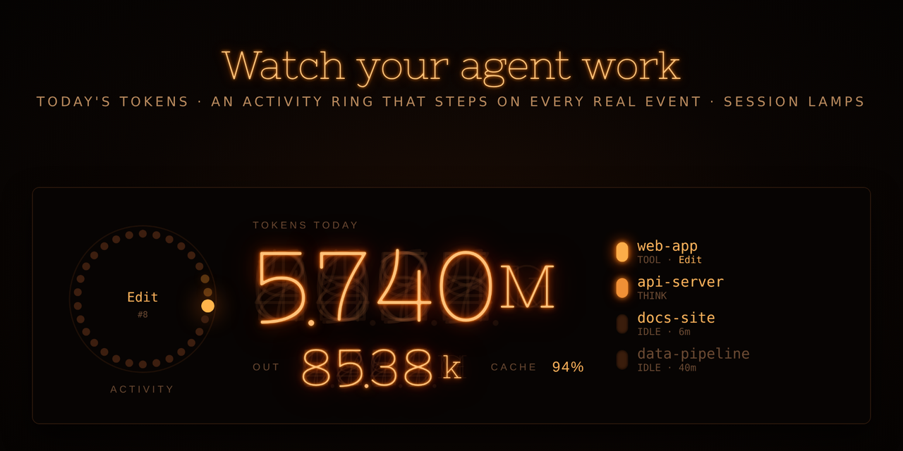

# Nixie Token Monitor — backend

Free backend for **Nixie Token Monitor**, an iCUE widget for the CORSAIR XENEON EDGE that shows
Claude Code at work on nixie tubes: today's token count, a dekatron that steps on every real
hook event, per-session status lamps, and a flashing border while a session waits for your approval.

The widget is available on the Elgato Marketplace. This repository contains the small helper
program (`ccnixie-hook.exe`) that the widget needs.

日本語の説明は [README.ja.md](README.ja.md) にあります。



> Not affiliated with or endorsed by Anthropic, CORSAIR or Elgato.
> "Claude" and "Claude Code" are trademarks of Anthropic.

## Requirements

- Windows 10 / 11
- [Claude Code](https://docs.claude.com/en/docs/claude-code/overview)
- iCUE with a XENEON EDGE and the Nixie Token Monitor widget

## Install

1. Download `ccnixie-hook.exe` from the [latest release](../../releases/latest).
2. In PowerShell, in the folder you downloaded it to:

   ```powershell
   .\ccnixie-hook.exe install
   ```

   You can also double-click the file and answer `y`.
   Windows may warn that the file is from an unknown publisher (it is not code-signed).
   Choose **More info → Run anyway**, or run `Unblock-File .\ccnixie-hook.exe` first.
3. Restart Claude Code and use it once. The widget switches from the DEMO view to your data.

Check that everything works:

```powershell
& "$HOME\.claude\icue\ccnixie-hook.exe" status
```

`8/8 events registered` and a recent `updated` time mean you are done.

## What `install` changes

- Copies itself to `%USERPROFILE%\.claude\icue\ccnixie-hook.exe`.
- Adds one hook entry to each of these events in `%USERPROFILE%\.claude\settings.json`:
  `SessionStart`, `UserPromptSubmit`, `PreToolUse`, `PostToolUse`, `Notification`,
  `SubagentStop`, `Stop`, `SessionEnd`.
- Your other settings and hooks are kept as they are, in the same order.
- A backup is written next to it first: `settings.json.ccnixie-bak-YYYYMMDD-HHMMSS`.
- If `settings.json` is not valid JSON, it stops and changes nothing (it tells you the line).
- Running `install` again (for example after an update) replaces its own entries; it never duplicates them.

## Uninstall

```powershell
& "$HOME\.claude\icue\ccnixie-hook.exe" uninstall
```

This removes only its own hook entries (with a backup). Then delete the folder
`%USERPROFILE%\.claude\icue` and remove the widget in iCUE.

## Privacy

- Everything stays on your PC. The program makes **no network connections**.
- It reads the hook event that Claude Code passes to it, and the local Claude Code transcript of that
  session **only to add up token counts** (`usage` numbers). Prompts and code are not stored or copied.
- It writes one small file, `%USERPROFILE%\.claude\icue\state.json`
  (token totals, session folder names, current status and tool name), which the widget reads.
- It does not read Claude login credentials and does not call any API.

## How it works

```
Claude Code ── hook event (stdin) ──▶ ccnixie-hook.exe ──▶ ~/.claude/icue/state.json ──▶ iCUE widget
                                            │
                                            └─ reads new lines of the session transcript (token usage)
```

- Token totals are today's (local date) input + output + cache write + cache read tokens,
  de-duplicated per message.
- Status per session: `think` (working), `tool` (running a tool), `wait` (permission prompt), `idle`.
- The program exits immediately and never prints anything, so it cannot disturb Claude Code.

## Limitations

- Windows only (iCUE is Windows only).
- Tokens used by subagents (separate transcripts) are not counted yet.
- Counts come from local transcripts and are for display only; they are not your bill or your plan limits.

## Build from source

Requires Go 1.22+.

```bash
cd backend
GOOS=windows GOARCH=amd64 go build -trimpath -ldflags "-s -w" -o ccnixie-hook.exe .
```

Release binaries are built by GitHub Actions from the tagged source (see `.github/workflows/release.yml`).

## Support

Please open an [issue](../../issues).

## AI disclosure

This project was developed with the assistance of Claude (Anthropic).

## License

[MIT](LICENSE)
